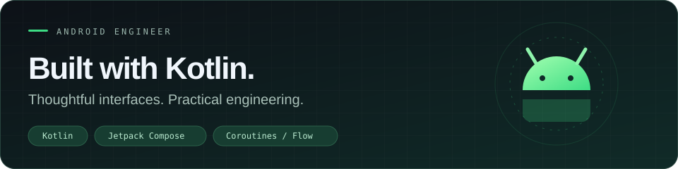

# Hi, I'm Evgenii 👋  
**Android Engineer (Kotlin, Jetpack Compose)** • 4+ years • shipped production apps • subscriptions & analytics • CI/CD • security-focused features  
📍 Saint Petersburg, Russia • Open to relocation (UAE)

## What I do

I build production Android applications with a strong focus on:
- **Product engineering** (subscription monetization, analytics, A/B testing)
- **Performance & reliability** (startup, memory, crash-free sessions mindset)
- **Clean architecture** (scalable modular codebases, SOLID, MVVM/MVI)
- **Security** (on-device risk scoring, APK scanning integrations)

---

## Highlights
- Launched and owned the full release cycle of a **Google Play antivirus app** (architecture → signing → policies → post-release improvements)
- Implemented **Google Play Billing v6** (multiple plans, trials, regional pricing) and improved subscription conversion
- Built an **analytics abstraction** (Firebase + AppMetrica) with funnels and Remote Config experiments
- Designed an on-device **Risk Scoring Engine** (20+ signals, 0–100 score)
- Created/optimized **GitLab CI/CD** pipelines to reduce manual release work

---

## Core stack
**Kotlin**, **Jetpack Compose**, XML  
Coroutines / Flow • MVVM / MVI • Clean Architecture • SOLID  
Hilt / Dagger • Retrofit / OkHttp • Room / DataStore • WorkManager  
Firebase (Analytics/RC/Crashlytics) • AppMetrica • GitLab CI/CD

---

_(I can share details and demos upon request.)_

---

## Contact Me :

If you want to reach out to me about anything, be it some doubt or just to hangout and talk or want to game together just ping me 😉.

 
 

 
 
 

---

  

<table>
<tr>
<td width="50%" valign="top">

### 🗡️ Pokedex
**A Compose take on the Pokémon universe.**

Browse Pokémon and search by name in an app built with Kotlin, Jetpack Compose, Hilt and MVVM.

[Explore the project →](https://github.com/DivisionCom/pokedex)

</td>
<td width="50%" valign="top">

### 🌤️ Weather App
**The forecast, wherever you are.**

Hourly and daily forecasts, city search and location-based weather in a Kotlin Android application.

[Explore the project →](https://github.com/DivisionCom/weather-app)

</td>
</tr>
</table>

  <a href="https://github.com/DivisionCom?tab=repositories">View all repositories →</a>

